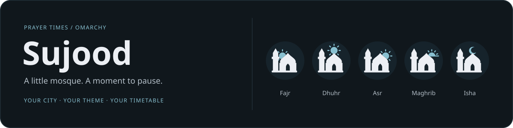
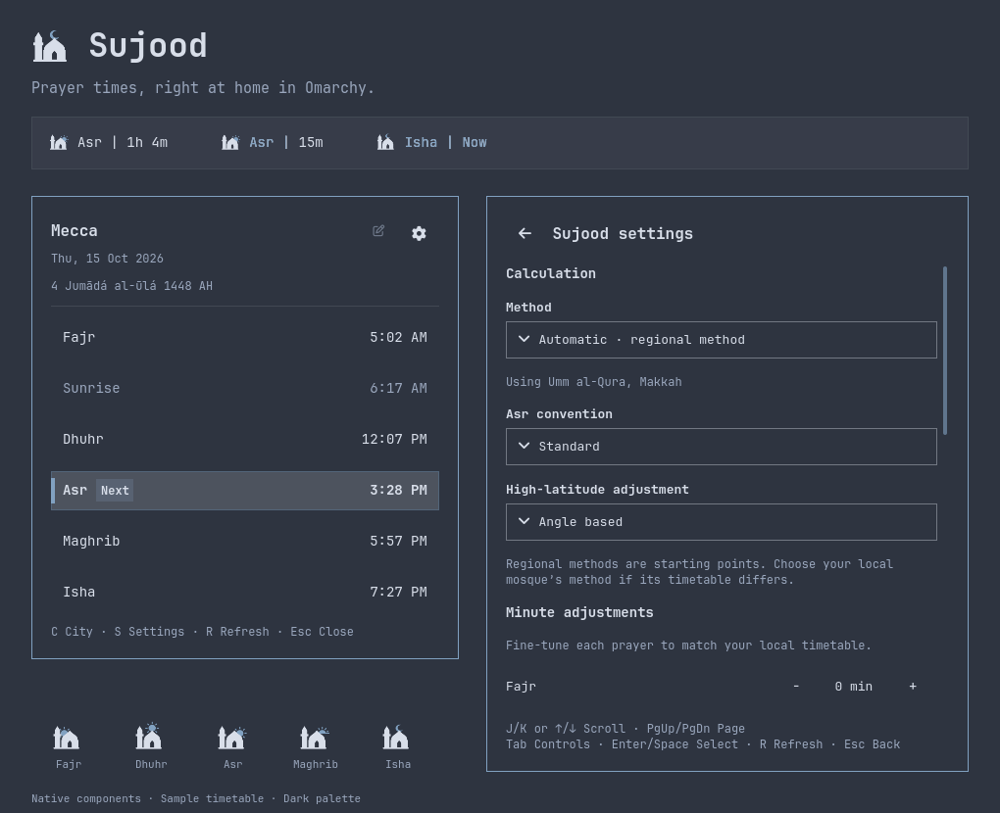
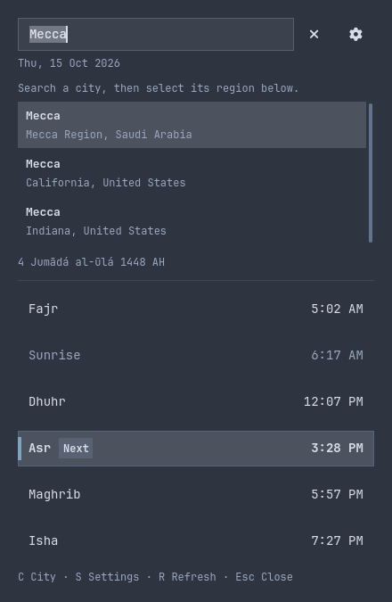

<div align="center">



### Your prayers. Your city. Your Omarchy. 🕌

A tiny mosque that follows the sky, a countdown that comes alive before prayer,<br>
and a timetable that wears your favourite theme.

**Location-aware calculations** &nbsp; · &nbsp; **Native theme colours** &nbsp; · &nbsp; **Keyboard controls**

[Get started](#install) · [Explore the features](#a-quiet-bar-a-clear-reminder) · [Keyboard shortcuts](#keep-your-hands-on-the-keyboard) · [Under the hood](#under-the-hood) · [Uninstall](#uninstall)

<picture>
  <source media="(prefers-color-scheme: light)" srcset="docs/images/sujood-light.png">
  
</picture>

</div>

## Install

Sujood **0.1.1** is an **Omarchy Quickshell bar plugin**. It needs the Omarchy shell that provides `qs.Commons`, `qs.Ui`, and the `omarchy plugin` commands. It does not run inside a terminal or TUI, or on an older Waybar-only installation.

From a terminal in your Omarchy desktop session:

```bash
omarchy plugin add https://github.com/mxkkyexe/Sujood.git --enable
```

Choose a bar section when prompted. Open the mosque icon, then click the city name—or press **C**—to choose your location. If an existing Omarchy weather location is available, Sujood uses it as a starting point. Your prayer location is independent after that.

Runtime dependencies are Python **3.9+**, timezone data, `notify-send`, and `paplay` for the optional chime. No pip packages, npm packages, accounts, or API keys. If these system packages are missing:

```bash
omarchy pkg add python tzdata libnotify libpulse
```

Disable any other prayer widget before enabling Sujood if you want to avoid duplicate notifications. Sujood does not remove other plugins or change your calculation preferences behind your back.

If Omarchy keeps showing an old cached version after an update:

```bash
omarchy restart shell
```

## A quiet bar. A clear reminder.

### 🌅 A tiny skyline that follows the next prayer

Five original vector icons share a solid mosque and one minaret. The sky changes around it: dawn rises on the left, midday shines above the dome, the afternoon sun moves right, sunset rests on a clean right-hand horizon, and a small crescent marks Isha.


The bar shows a compact label such as **`Asr | 1h 4m`**. On a vertical bar, the icon remains compact and the countdown lives in its tooltip.

### 🎨 Colour with a purpose

Sujood reads the active Omarchy theme, including its foreground, accent, muted text, fonts, spacing, borders, and control styling. Theme switches update the widget and its panels together. The mosque follows the foreground; the sun and crescent follow the accent. White is never assumed.

| State | What you see |
| --- | --- |
| More than 30 minutes away | Normal theme foreground; a quiet countdown. |
| Final 30 minutes | The accent progressively fills the existing text from left to right, with a soft pulse travelling smoothly through the filled portion. At 15 minutes, the fill is halfway across. |
| Prayer time | **`Asr | Now`** stays for one minute. The whole label briefly brightens, settles into the accent, then breathes gently every three seconds. The mosque icon stays accented for that minute. |
| Incoming prayer in the panel | A full-row highlight, accent strip, bold name/time, and **Next** badge. At arrival, the badge becomes **Now**. |
| After Isha | Fajr is marked **Next · Tomorrow** and shows tomorrow's actual Fajr time; the remaining rows still show today's times. |
| Sunrise | Muted in the timetable unless it is the selected next event. |


The countdown advances to the next event after that minute. Prefer stillness? Turn off **Countdown animation** to keep a static progress fill and accented **Now** label.

### 📍 Your timetable, without the clutter

Click the bar icon for the location, Gregorian and Hijri dates, five prayers, and sunrise. The countdown stays in the bar; it does not take over the panel again.

Hover the city name for a highlight and pencil cue, then click to search in place. Suggestions include the region so you can distinguish cities with the same name. Use arrows and Enter to choose, or Escape to cancel. Calculation and reminder preferences live on a separate settings page.



### ☀️ Sunrise, if you want it

**Show sunrise in bar** adds **`Sunrise | …`** between Fajr and Dhuhr, reusing Dhuhr's sun icon. The option is off by default. Turn it off to count directly to Dhuhr after Fajr.

Sunrise gets the same progress fill and one-minute **Now** display. Desktop prayer notifications and sound remain limited to the five prayers. Sunrise stays in the timetable either way.

### 🔔 Gentle reminders

Enable desktop alerts, a short system chime, or both. Notifications are claimed persistently so multiple monitors and shell restarts do not produce duplicate reminders. Sujood skips prayers that had already passed when it started. A wake-up within the first minute can still alert; older missed events do not create a backlog of notifications.

Alerts run while the widget is loaded in the Omarchy shell. Sujood cannot alert while the computer is asleep or the shell is stopped.

## Keep your hands on the keyboard

These shortcuts work **while the panel is open**:

| Key | Action |
| --- | --- |
| **S** | Open settings |
| **C** | Edit the city |
| **R** | Refresh cached prayer times (timetable or settings) |
| **J / K** or **↓ / ↑** | Scroll settings down / up |
| **Page Down / Page Up** | Move a page |
| **Home / End** | Jump to the top / bottom |
| **Tab / Shift+Tab** | Move between controls; the focused control scrolls into view |
| **Enter / Space** | Activate a button, choice, or toggle |
| **Esc** | Cancel city editing, return from settings, or close the timetable |

Press **R** in the timetable or settings to re-fetch both cached calendar months. Right- or middle-clicking the bar icon does the same. Existing cached times remain available if the refresh fails.

City search keeps normal typing and uses arrow keys plus Enter for suggestions. Hints appear in each page's footer.

Want your own desktop binding? Bind this command through your Hyprland configuration:

```bash
omarchy-shell shell toggle mxkkyexe.sujood
```

Sujood does not claim a global key combination automatically.

## The right method, with the final say left to you

**Automatic** picks a regional calculation method from the selected city's country. Canada, the US, and Mexico use **ISNA North America**. Sujood also includes country defaults for Karachi, Umm al-Qura, Egyptian General Authority, and supported regional methods across parts of Europe, North Africa, the Gulf, and Southeast Asia. Countries without a specific mapping fall back to **Muslim World League**.

The selected method is visible in settings and can always be overridden. The full mapping lives in [`backend.py`](backend.py); this is Sujood's policy, not Pillars' selection algorithm or a guarantee of agreement with every local mosque.

Settings also include:

- **Standard or Hanafi Asr**, independently of the calculation method.
- **Angle-based, middle-of-night, or one-seventh high-latitude handling**.
- **Per-prayer minute offsets** from −60 to +60 minutes.
- **12- or 24-hour time**, bar countdown visibility, sunrise visibility, alerts, sound, and countdown animation.

Aladhan labels its Turkey and Dubai methods experimental; Sujood preserves that label in the selector. Regional defaults are a starting point—use your local mosque's method and adjustments where appropriate.

## Under the hood

Small pieces, straightforward responsibilities:

```text
Omarchy theme ──→ QML interface + SVG icons
                       │
                 PrayerService.qml
                       │  short-lived Python process / JSON
                   backend.py
                    ├── Open-Meteo / GeoNames → city, coordinates, country, timezone
                    ├── Aladhan → prayer calendar with timezone-aware timestamps
                    └── local JSON → preferences, calendar, notification claims
```

- **QML** draws the bar, timetable, city editor, settings, and text effects using Omarchy's native controls. The shared service coordinates widget instances across monitors.
- **Python's standard library** handles geocoding requests, regional method selection, calendar retrieval, validation, state files, and notification deduplication. There is no persistent Python daemon or web server.
- **[Aladhan](https://aladhan.com/prayer-times-api)** performs the astronomical prayer calculations. Sujood sends coordinates, calculation method, Asr convention, timezone, and high-latitude rule, then applies any minute adjustments locally. It does not implement its own astronomical calculator.
- **[Open-Meteo](https://open-meteo.com/en/docs/geocoding-api)** supplies location search, using GeoNames data. The selected result includes the country and timezone needed for regional selection and scheduling.
- **`Model.js`** selects the upcoming event from dated UTC timestamps and computes the label, progress, arrival interval, and timetable emphasis. It does not reinterpret another city's times in your computer's timezone.

### Cache once, count down locally

Sujood caches the current and next calendar month. The visible countdown ticks locally every second; it does **not** make a network request every second. The backend checks calendar coverage periodically and downloads months only when needed, after a calculation/location change, or on a forced refresh.

Dated timestamps and timezone-aware day boundaries handle DST, midnight, month/year rollover, and tomorrow's actual Fajr. Valid cached dates keep working offline. Missing data or failed refreshes show an error and retry after five minutes; changing calculation settings does not silently reuse a calendar from another method. New dates still require a connection—there is no offline astronomical engine in this MVP.

### Local state and privacy

State lives in `$XDG_STATE_HOME/omarchy/sujood/`, normally:

```text
~/.local/state/omarchy/sujood/
├── settings.json    # your preferences and selected city
├── calendar.json    # dated prayer times
├── notified.json    # recent notification claims
└── alerts.lock      # coordinates notification claims across processes
```

Your city search text goes to Open-Meteo; coordinates and calculation options go to Aladhan. Preferences and cached calendars stay on your machine. There is no Sujood account, analytics, or tracking service.

The widget sends helper payloads through stdin so city searches and saved coordinates do not appear in helper command lines. Network requests are restricted to the two providers over verified HTTPS; redirects are rejected and each response is limited to 2 MiB. Oversized or rejected refreshes keep the matching cached timetable available.

On first use, Sujood can import the original prayer widget's alert/Asr preferences and Omarchy weather location. It also preserves settings, cached dates, and notification claims from the pre-release `makkyexe.prayer` version. Later location changes in Sujood do not change weather.

For isolated development, use `SUJOOD_STATE_DIR` or the backend's `--state-dir`. The older `PRAYER_STATE_DIR` override remains supported for compatibility.

## Update

```bash
omarchy plugin update mxkkyexe.sujood
```

## Uninstall

Run this in your terminal and confirm the prompt:

```bash
omarchy plugin remove mxkkyexe.sujood
```

Omarchy unloads Sujood and removes its installed plugin folder. Your saved city, preferences, and cached prayer times stay on disk, ready if you reinstall.

For a complete cleanup, you can also delete Sujood's saved state **after uninstalling**. This permanently removes those preferences and cached times:

```bash
rm -r -- "${XDG_STATE_HOME:-$HOME/.local/state}/omarchy/sujood"
```

If you configured `SUJOOD_STATE_DIR` or `PRAYER_STATE_DIR`, your state is in that custom directory instead. Any older prayer plugin's files remain separate.

## Development

The repository contains the final plugin, its five SVG sources, current documentation images, and the tools/tests needed to maintain them. There is no build step for installation.

```bash
python3 -m unittest discover -s tests -v
node tests/model.test.js
python3 tools/check-keyboard.py
omarchy plugin validate .
```

Node is a development-only dependency. The keyboard check uses Quickshell, QtTest, and the installed Omarchy components, with isolated sample state and no network. It exercises real key events, forced refresh, scrolling bounds, focus visibility, city typing, and Escape navigation.

After editing an SVG:

```bash
python3 tools/build-icons.py
```

That regenerates `Icons.js`, which substitutes the active theme colours at runtime. Documentation previews can be regenerated on an Omarchy development machine with `python3 tools/render-previews.py`; they use sample data and do not change your desktop theme or saved city.

## Credits & license

Created by [mxkkyexe](https://github.com/mxkkyexe). Inspired by [Husam Emad's Omarchy prayer-times plugin](https://github.com/husamemadH/omarchy-quattro-prayer-times), with its MIT notice retained. The mosque-and-sky icon set was developed for Sujood. Omarchy supplies the native shell controls and theme system; Aladhan and Open-Meteo/GeoNames supply the prayer and location data.

[MIT](LICENSE). Built to help prayer stay present in your day. 🤍
